<p align="center">
  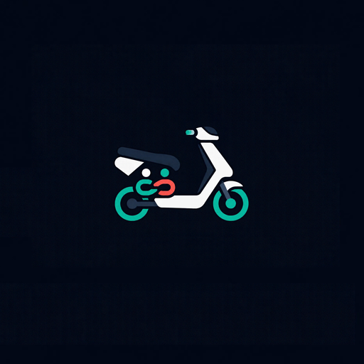
</p>

<h1 align="center">AtherMate</h1>

<p align="center"><b>An independent companion app and home-screen widget for your Ather electric scooter.</b></p>

> [!NOTE]
> **Credits** — AtherMate is a fork of **[Athr+](https://github.com/karmugilen/athr-plus)**, created and open-sourced by **[@karmugilen](https://github.com/karmugilen)**. The original app, its architecture, documentation, and the entire v1.1.x line are the original author's work; this fork exists only because Athr+ was worth continuing. Please star and support the [upstream project](https://github.com/karmugilen/athr-plus) too.

## What this fork adds

AtherMate continues where Athr+ left off, on top of the original v1.1.16:

- **Charging session history:** every detected charge is logged locally with start/end battery percentage, duration, estimated energy, and rupee cost at your tariff, grouped into calendar-month totals on the Charging tab. The in-progress session survives process restarts.
- **Charging widget:** a second, deliberately simple widget for the home screen and lock screen — one big battery percentage, a charge progress bar, and the vehicle-reported ETA. Manual refresh works even when monitoring is stopped.
- **Weekly and monthly ride insights:** distance, riding time, rupees saved against an assumed 45 km/L petrol bike at your petrol price, and the most efficient ride of the period, computed from trips already stored on the device.
- **Personalised range learning:** your actual consumption (distance-weighted Wh/km over the last 30 days of trips) shifts the dashboard range and per-mode tiles toward how you really ride, blended with Ather's reported range by observed distance.
- **Direct Bluetooth connection:** the app can talk to scooter-side peripherals over BLE without the cloud in the middle.
- **Vehicle link (Ather BLE protocol):** pair with the scooter dash by scanning its QR code (or tapping its pairing link) and the dash connects to the phone over the reverse-engineered Ather BLE profile — the full five-service GATT server (call, media, WhatsApp, navigation, voice) with the genuine Ather beacon and token crypto. Once paired, real phone events reach the scooter: now-playing from any music app (title, artist, elapsed time), incoming calls with caller names, WhatsApp calls, and WhatsApp messages (with notification access); dash buttons answer/reject calls and control music playback, and payloads sent while the dash is away are delivered when it reconnects. The phone re-advertises after every disconnect and holds a wake lock so the dash can always find it again.
- **Send a destination to the dash:** share any place from Google Maps (or open a `geo:` link) with AtherMate and the scooter dash gets the destination plus live distance-and-direction updates while you ride, ending with an arrival notice.
- **QR pairing, maintenance reminders, notification progress, profile persistence, and a refreshed brand identity.**

## Screenshots

The current app (account name pixelated in Settings):

| Dashboard | Charging history | Charger connected |
| :---: | :---: | :---: |
| 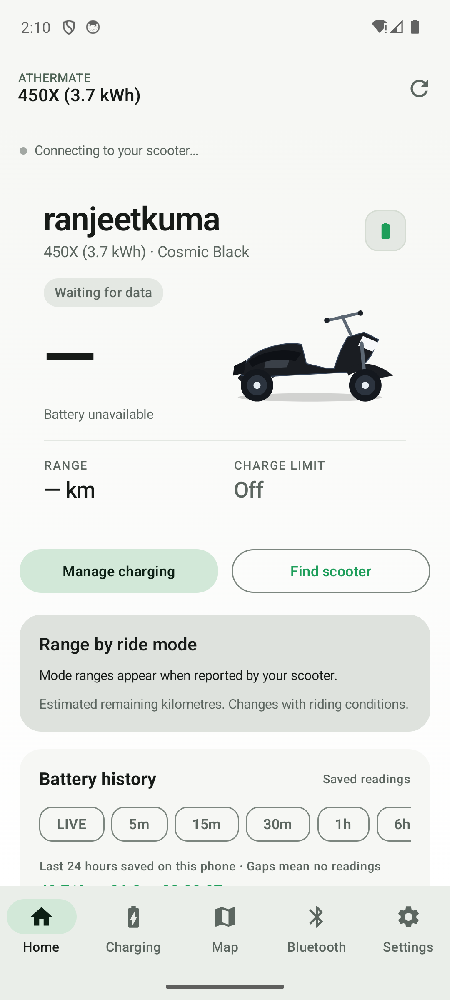 | 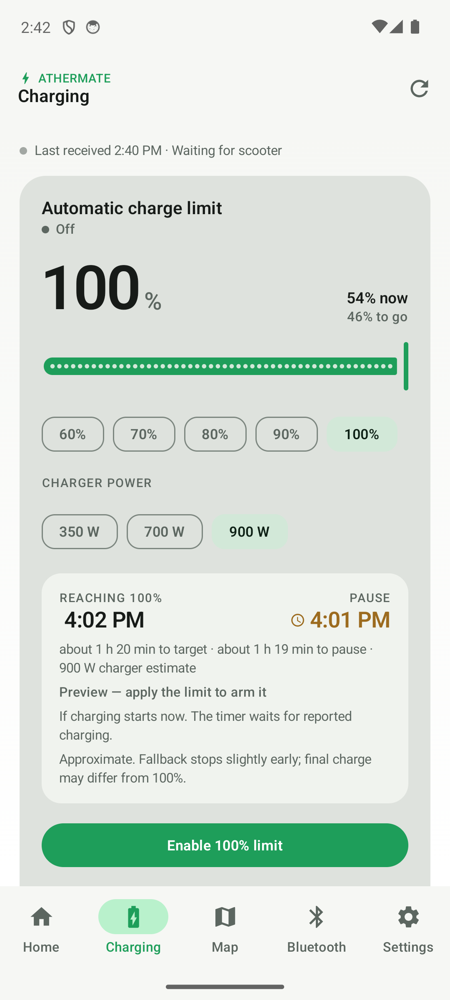 | 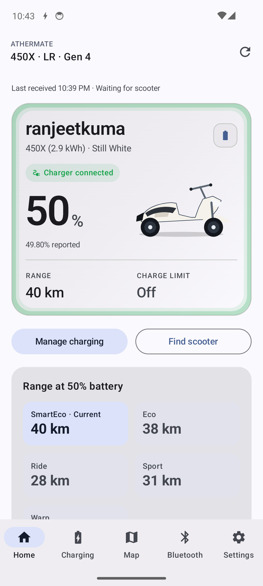 |
| 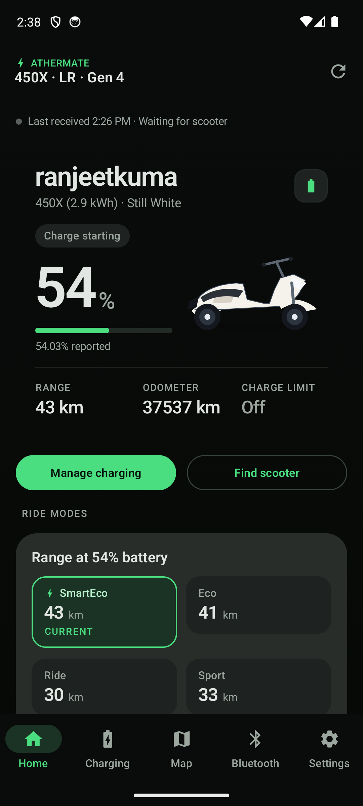 | 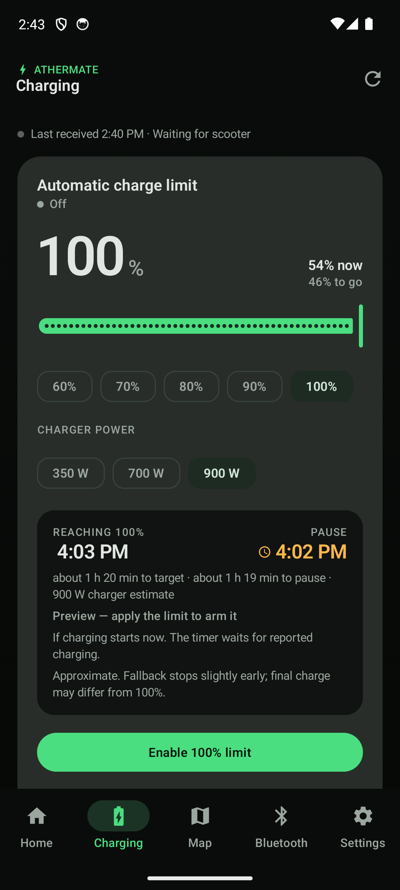 | 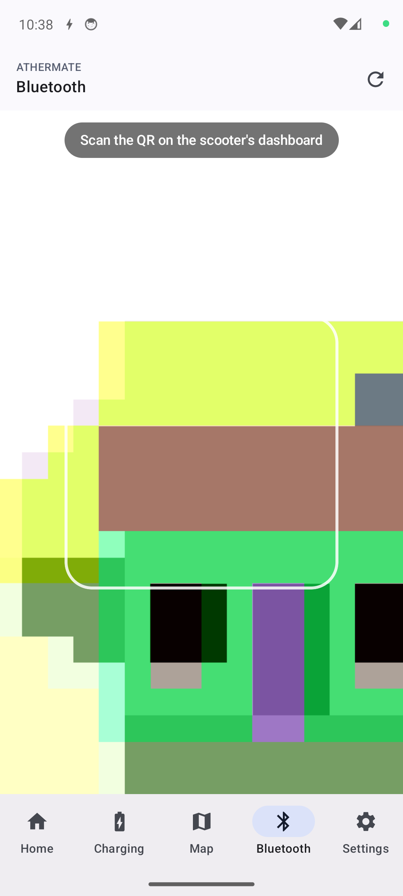 |

| Settings | Charging notification |
| :---: | :---: |
| 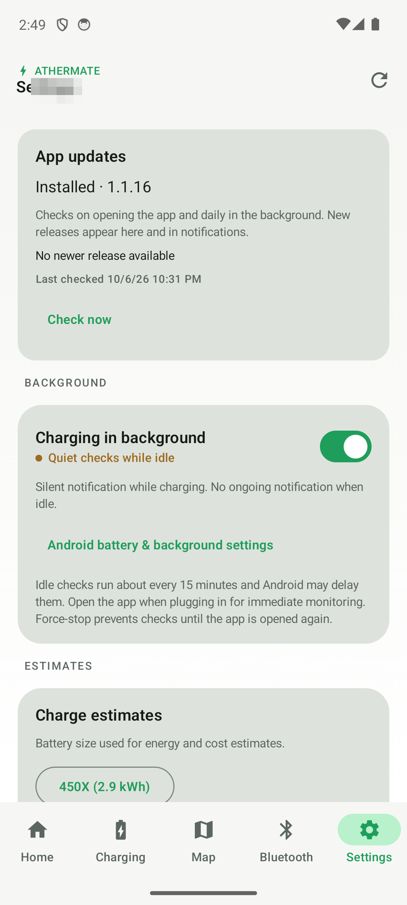 | 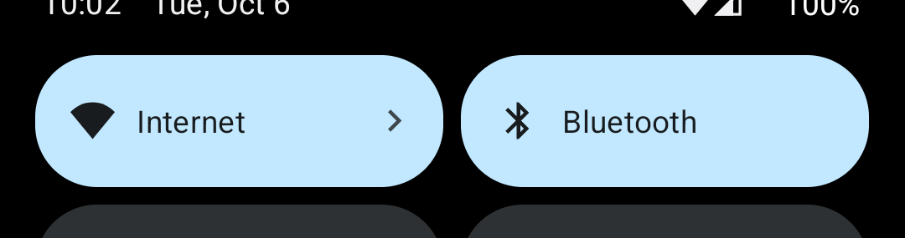 |

<details>
<summary>Earlier upstream screenshots (Athr+ v1.1.x)</summary>

| Dashboard | Charge limit | Street map |
| :---: | :---: | :---: |
| 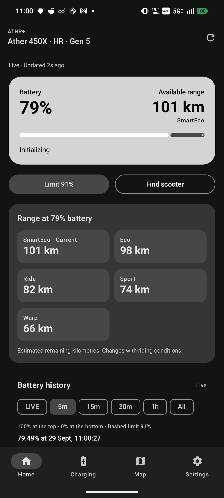 | 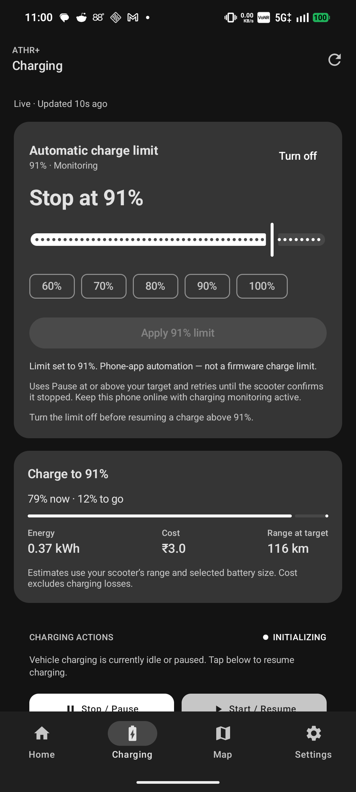 | 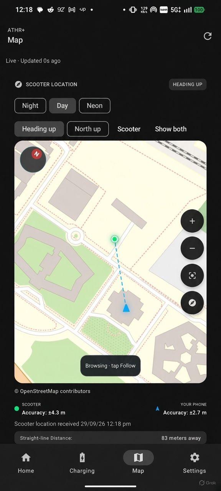 |

<details>
<summary>Earlier home-screen widget</summary>
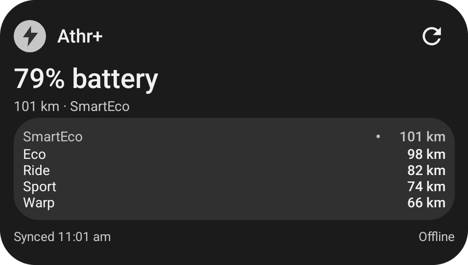
</details>
</details>

## Download and update

**[Download the latest release](https://github.com/PaswanRaunak/athermate/releases/latest)** · **[v1.2.1 release notes](https://github.com/PaswanRaunak/athermate/releases/tag/v1.2.1)**

Requires Android 8.0 or newer. Download the `AtherMate-v1.2.1-release.apk` asset and install it. If you are coming from the original Athr+ app, install AtherMate as a new app first — it is a separate build with its own signing identity and does not install over Athr+. Android may ask you to allow installation from your browser or file manager.

Version **1.2.1 (build 22)** is a signed, non-debuggable release with R8 code optimization and resource shrinking. Published stable releases appear in the app with release notes, a download button, and Android's installation confirmation; you can also use **Settings → App updates → Check now**. Checks run on opening the app at most once every six hours and approximately daily in the background; Android may delay background work. A source push alone does not trigger an app update. Downloaded APKs are checked for package, version, signing certificate, size, and checksum before installation.

## Support the project

If the app is useful to you, consider supporting the people behind it.

- **Original Athr+ author** ([@karmugilen](https://github.com/karmugilen)) — UPI: `karmugilrc-1@okaxis`. AtherMate would not exist without the original project.
- **This fork** — the in-app **Settings → Support the project** screen sends contributions to the fork's maintainer.

## Why This Project Exists

The original author built **Athr+** because the official app became frustrating to use:

- **Missing from Play Store**: If your phone has an unlocked bootloader or runs a custom ROM, the official app doesn't show up in the Google Play Store.
- **Developer Options Block**: If you keep Developer Options enabled, the app constantly stops you with "Turn off developer options" warnings.
- **Paid for Pro, Couldn't Use It**: Even after paying for the official Ather Pro pack, the app gave a frustrating experience with artificial device blocks.

Athr+ gave everyone full, unrestricted access to their own scooter—live battery status, smart charging limits, home screen widgets, and ride history—without any annoying device blocks. AtherMate keeps that mission going.

## Features

- **Battery and scooter information:** battery percentage, charging state, location, odometer, and per-mode range when supplied by the vehicle API. Active monitoring requests data every five seconds; the scooter/cloud may return older readings, so requests do not guarantee fresh data every five seconds.
- **Charge limiter:** choose a target percentage and see an estimated stop time. Monitoring can request a stop when the measured level reaches the target or the saved estimated deadline arrives. Estimates are approximate, and stopping depends on Android background execution, connectivity, and the scooter accepting the command.
- **24-hour battery history:** local measured samples with source timestamps; repeated cached readings do not become invented new measurements.
- **Charging session history:** every detected charge (flag-on to flag-off of at least five minutes with measurable SoC movement) is logged locally with start and end battery percentage, duration, estimated energy, and rupee cost at your tariff, grouped into calendar-month totals on the Charging tab. Costs keep the tariff in effect when each session ended. The in-progress session survives process restarts.
- **Weekly and monthly ride insights:** distance, riding time, rupees saved against an assumed 45 km/L petrol bike at your petrol price, and the most efficient ride of the week or month, computed from the trips already stored on the device.
- **Personalised range learning:** your actual consumption (distance-weighted Wh/km over the last 30 days of trips, with noise floors) shifts the dashboard range and per-mode tiles toward how you really ride, blended with Ather's reported range by observed distance (up to 70% weight at 300 km). With no vehicle-reported range at all, 10+ observed kilometres are enough to stand in for it.
- **Material 3 appearance:** system light/dark mode and wallpaper-derived colors on Android 12 and newer, with a Material palette on older phones.
- **Home-screen widgets:** the classic widget with battery, current range, clear per-mode range rows, sync time, connection status, and a limiter bar when enabled, plus the charging widget for the lock screen. Widget colors follow system appearance changes.
- **Model-independent battery artwork:** an animated battery while charging and the scooter launcher icon.
- **Rust calculations:** native history selection, range scaling, and charging estimates for ARM and x86 devices.
- **Phone sign-in:** searchable country calling codes (India +91 by default), international number paste, country-aware validation, and SMS code resend with a countdown. OTP delivery for each country depends on the account provider.
- **Smooth map interaction:** display-paced heading animation and a request for the fastest supported refresh rate up to 144 Hz while a map is open. Actual frame rate depends on the device, Android settings, and WebView.
- **Maps and ride analytics:** Leaflet street maps, vehicle heading, local trip history, and available battery/efficiency information.
- **Verified app updates:** public GitHub release checks without a GitHub login; downloaded APKs are checked for package, version, signing certificate, size, and available checksum before installation.

## Build

Requires JDK 17 or 21, Android SDK API 34, Build-Tools `34.0.0`, NDK `26.1.10909125`, and Rust with these targets:

```sh
rustup target add aarch64-linux-android armv7-linux-androideabi x86_64-linux-android i686-linux-android
```

Configure `android/local.properties` with your SDK path (`sdk.dir=/path/to/Android/Sdk`), or set `ANDROID_HOME`. Local properties and generated build files are ignored by Git.

```sh
# Development build
JAVA_HOME=/path/to/jdk-21 ./android/gradlew -p android assembleDebug --console=plain

# Optimized public build: configure the signing key first.
# See docs/APP-UPDATES.md for the four signing environment variables.
JAVA_HOME=/path/to/jdk-21 ./android/gradlew -p android assembleRelease --console=plain
JAVA_HOME=/path/to/jdk-21 python3 scripts/prepare-release.py android/app/build/outputs/apk/release/app-release.apk
```

The release APK is generated at `android/app/build/outputs/apk/release/app-release.apk`. The packaging script verifies its signing certificate and release identity, scans for locally known private account values, and creates the APK, SHA-256 checksum, and `update.json` under `android/app/build/release-upload/`.

See [publishing and verifying updates](docs/APP-UPDATES.md) for local release steps and optional GitHub Actions signing. Release signing requires the original app key to preserve upgrade compatibility. Keep that key outside Git.

## Development

The app uses Kotlin 2.0, Jetpack Compose, Material 3, OkHttp, Gson, Room, WorkManager, and Rust through JNI. Leaflet runs inside an Android WebView.

```text
android/app/src/main/java/io/ather/pro/
  data/           API clients, local storage, Rust bridge, app updates
  domain/         Charging rules, battery history, ranges, data models
  presentation/   ViewModels and screen state
  service/        Monitoring and background work
  ui/             Compose screens, themes, and navigation
  widget/         Home-screen widget snapshots and rendering
rust/ather-math/   Native calculation library
scripts/          Local API tools, release packaging, credential guards
docs/             Feature and publishing documentation
```

Optional developer checks:

```sh
./android/gradlew -p android test
./android/gradlew -p android lintRelease
```

For desktop OTP login, telemetry, and charging API experiments with credentials stored outside Git, see [the desktop API lab](docs/LOCAL-API-LAB.md). Do not share session files or include them in a release.

## Privacy and credentials

Scooter sign-in uses your OTP, and session data stays in local app storage. The app uses Android Keystore-backed encrypted preferences where available, with a private preferences fallback if encrypted storage cannot be initialized. GitHub update requests do not use scooter credentials.

Keystores, local properties, APKs, and local API session files are excluded from Git. The local commit/push guard checks private file paths, credential patterns, and known local account values. These safeguards complement reviewing changes before publishing; they are not a substitute for that review.

## Legal Notice & Disclaimer

> [!NOTE]
> **Notice**: This application was developed independently using exclusively publicly available information, standard open network protocols, and resources accessible online. It contains no proprietary source code, confidential intellectual property, or trade secrets.
>
> This project is completely independent and is not affiliated with, authorized, maintained, sponsored, or endorsed by any vehicle manufacturer, automotive brand, or corporate entity. All trademarks, service marks, trade names, and product names are the property of their respective owners. The software is provided solely for personal interoperability, research, educational, and hobbyist purposes.
>
> AtherMate is a fork of [Athr+](https://github.com/karmugilen/athr-plus) by [@karmugilen](https://github.com/karmugilen); the original project's work is acknowledged with thanks.
